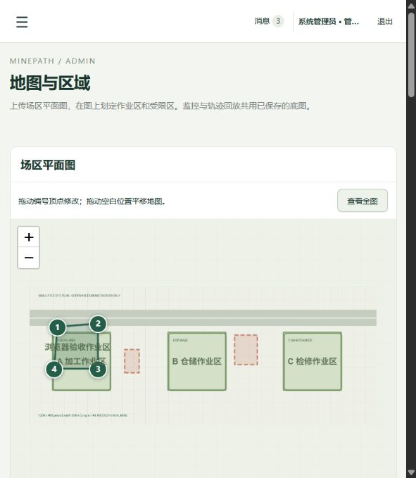
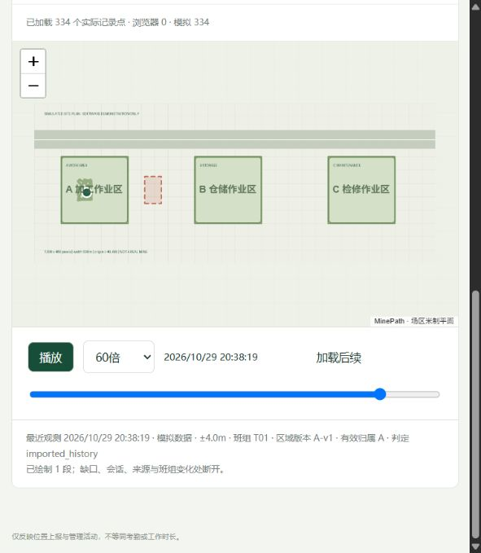
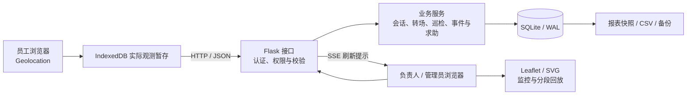

# 矿迹 MinePath

**基于 Web 的矿厂人员轨迹监控与可视化系统**

面向矿厂地面露天区域的本科毕业设计原型，将人员位置与班组、作业会话、区域版本和处理记录关联起来，支持现场监控、轨迹回放、转场管理、巡检与求助处理。

采用 Python / Flask + SQLite + 原生 JavaScript，静态组件本地提供，运行界面无需地图服务密钥或外部 CDN。当前为本地演示项目，尚未在真实矿厂部署。

## 界面预览

以下截图来自 v1.2 的独立演示环境，底图、人员和位置均为模拟数据。

| 场区底图与区域编辑 | 历史轨迹回放 |
| --- | --- |
|  |  |

## 主要功能

| 角色 | 功能 |
| --- | --- |
| 员工 | 开始/结束位置上报、离线暂存与补传、个人轨迹、转场执行、事件说明、求助与结果确认、被指派后的巡检 |
| 班组负责人 | 本组监控与轨迹回放、区域分配、转场下达及到达确认、事件核查、求助处理、巡检指派、班组报表 |
| 管理员 | 账号/班组/设备管理、调组与管理委派、底图上传、区域绘制和版本管理、全局监控、审计、备份及重复性评估 |

### 实现要点

- **按观测时间组织历史数据**：分别保存观测时间与服务端接收时间，按观测发生时的班组及区域版本关联记录。中途调组保留会话，后端按历史班组控制轨迹访问。
- **离线补传与幂等处理**：IndexedDB 仅暂存实际收到的定位回调；服务端逐条返回接受、重复或拒绝结果，校验会话及采集租约有效期。缺失时段保留为空缺，迟到点不刷新实时位置。
- **可追溯的转场流程**：负责人直接下达任务，员工点击“开始转场”后计时；允许绕行，途中继续检查受限区；超时核查、延期、到达确认、驳回与取消均保留记录。
- **底图与区域版本**：上传 PNG/JPG，设置图片实际宽度与平面原点，在图上绘制或拖动编辑多边形；监控和回放共用底图，历史观测不随换图改写。
- **提示与处置分离**：结合位置时效、不确定度、边界距离和连续观测生成提示；位置恢复与事件结案分别记录。求助支持无位置提交、照片、处理进展、员工确认和重开。
- **巡检与协助**：负责人/管理员指派巡检，员工记录区域或在岗人员检查结果；发现问题关联事件，正在巡检的本组员工可代负责人处理求助，保留主责及代处理人记录。
- **权限与审计**：服务端角色及班组范围校验、CSRF 防护、密码哈希、登录失败限速、参数化 SQL、关键操作审计及数据库备份校验。

## 技术架构



SSE 用于提示页面重新读取最新状态，不提供所有历史推送的逐条重放保证。前后端同源部署；默认 HTTP 服务使用 Waitress。

| 层次 | 技术 |
| --- | --- |
| 后端 | Python 3.12、Flask、Werkzeug、Waitress |
| 数据存储 | SQLite（WAL）、本地照片与备份文件 |
| 前端 | HTML、CSS、原生 JavaScript、Leaflet 1.9.4、SVG |
| 采集与通信 | Geolocation、IndexedDB、HTTP/JSON、SSE |
| 验证 | pytest、Flask 测试客户端、SQLite、Node.js 几何检查、独立 HTTP 测量脚本 |

## 快速启动

### 1. 准备环境

安装 **Python 3.12**。运行完整测试还需要 **Node.js 22 或更新版本**；启动系统本身不需要 Node.js。以下命令在项目根目录执行。

```bash
git clone https://github.com/rkwu52468-hue/minepath.git
cd minepath
python -m venv .venv
```

Windows PowerShell：

```powershell
.\.venv\Scripts\python.exe -m pip install -r requirements.txt
.\.venv\Scripts\python.exe tools/generate_thesis_simulation.py --output evidence/simulated/sim-20261028-v1
.\.venv\Scripts\python.exe run.py --demo
```

macOS / Linux：

```bash
.venv/bin/python -m pip install -r requirements.txt
.venv/bin/python tools/generate_thesis_simulation.py --output evidence/simulated/sim-20261028-v1
.venv/bin/python run.py --demo
```

生成器默认输出 1 万条和 10 万条确定性模拟观测，使用固定种子，**拒绝覆盖非空输出目录**；生成成功后无需每次启动都执行。首次 `--demo` 启动向空观测库导入 1 万条模拟历史。缺少 CSV 时不会导入历史，但仍可启动并使用管理员的模拟流。

服务启动后访问 **<http://127.0.0.1:8080/>**。停止时按 `Ctrl+C`。不要通过双击 `src/minepath/static/index.html` 打开系统，该页面依赖后端接口与静态资源路由。

Windows 完成依赖安装后也可双击 `Start-System.cmd`；脚本优先使用当前项目的 `.venv`，可通过 `MINEPATH_PYTHON` 指定其他解释器。

### 2. 演示账号

| 角色 | 账号 | 初始演示密码 |
| --- | --- | --- |
| 管理员 | `admin` | `Demo@2026!` |
| 班组负责人 | `leader01`、`leader02`、`leader03` | `Demo@2026!` |
| 员工 | `employee01` 至 `employee30` | `Demo@2026!` |

这些是程序初始化的虚构演示账号。首次建库可通过环境变量 `MINEPATH_DEMO_PASSWORD` 指定密码；已有账号密码不会随重启重置。默认服务仅监听 `127.0.0.1`，请勿直接使用演示密码对公网提供服务。

### 3. 建议演示顺序

1. 管理员登录，在现场总览启动模拟数据流，查看 30 名模拟员工的位置及上报状态。
2. 如需自定义底图，执行 `python tools/generate_site_plan_demo.py`，上传生成的 `evidence/simulated/site-map-demo-v1/site-plan-demo.png`。完整宽度填 `600` 米，左下角原点填 `(-40, -60)`；可在“地图与区域”绘制测试区域。
3. 负责人登录，筛选本组员工、查询轨迹并播放；向员工下达 A 区到 B 区转场任务。
4. 员工点击开始转场，申报到达；负责人核查后确认，也可演示延期或驳回。
5. 演示求助的接单、处理、员工确认或重开，以及巡检的指派、检查记录与问题上报。
6. 管理员查看审计记录，生成报表和备份。调组后核对前后时段的轨迹可见范围。

演示模拟流不等于 30 台真实手机。测试真实定位前先停止该员工的模拟采集并登记实际采集端。

## 手机定位测试

手机浏览器采集需要定位授权、可信 HTTPS 和前台运行。运行 `Start-Mobile-HTTPS.cmd` 前请阅读 [手机测试说明](docs/MOBILE.md)。该入口是局域网测试服务，不自动调整防火墙或系统证书信任设置。

只分享测试 CA 的公开证书，**不要分享 `data/tls/` 内的私钥**。锁屏、切后台和定位不可用均可能产生上报缺口。

## 测试与性能记录

安装依赖和 Node.js 后，在项目根目录运行：

```bash
python -m pytest tests -q
```

请先按快速启动步骤生成模拟输入，导入去重测试需要该固定输入。测试使用独立临时数据库，不修改演示运行库。`MINEPATH_NODE` 可指定 Node.js 可执行文件。GitHub Actions 在 Windows / Ubuntu、Python 3.12 环境执行测试。

历史版本的主要验证结果如下；它们属于各自固定协议，不能混合比较：

| 验证项 | 结果与条件 |
| --- | --- |
| v1.1 重复轨迹查询优化 | 固定 10 万条模拟观测、返回 3334 点、3 次预热后测量 31 次，完整 HTTP 查询及 JSON 解码中位耗时由 **115.4959 ms 降至 19.4540 ms**，降低约 **83.16%** |
| v1.1 未命中缓存的独立诊断 | 中位耗时 **53.2153 ms**，与上述重复查询分开记录，不能承诺所有查询都低于 40 ms |
| v1.2 地图功能 | **12/12** 固定地图验收通过，同时保留 **52** 项业务及轨迹检查；另有浏览器上传、绘制、监控与回放操作验证 |

详见 [性能与验证说明](docs/PERFORMANCE.md)。这些是本机模拟数据和软件测试结果，未完成真实矿区部署、手机定位精度或长期并发容量验证。

## 项目目录

```text
minepath/
├── run.py                     # 启动入口
├── requirements.txt           # Python 依赖
├── Start-System.cmd           # Windows 本地演示入口
├── Start-Mobile-HTTPS.cmd     # 手机 HTTPS 测试入口
├── src/minepath/
│   ├── core.py                # 存储、会话、时间关系与基础校验
│   ├── business.py            # 位置、转场、巡检与事件业务
│   ├── management.py          # 管理、报表、评估与维护
│   ├── site_maps.py           # 底图上传、校验和版本
│   ├── web.py                 # HTTP / SSE、鉴权与接口
│   ├── schema.sql             # 数据库结构
│   └── static/                # 页面、交互和本地 Leaflet
├── tests/                     # 业务、地图与轨迹响应契约测试
├── tools/                     # 模拟输入、测试与测量脚本
├── docs/                      # 使用、设计、接口和验证说明
├── evidence/                  # 生成的模拟输入及本机测试结果
└── data/                      # 运行时创建，不纳入版本控制
```

## 更多文档

- [操作说明](docs/USER_GUIDE.md)
- [底图上传与区域绘制](docs/MAP_GUIDE.md)
- [系统设计与业务规则](docs/SYSTEM_DESIGN.md)
- [API 清单与巡检接口](docs/API.md)
- [性能测试条件与结果](docs/PERFORMANCE.md)
- [公开版本整理说明](docs/PUBLICATION.md)

## 适用边界与开发说明

本项目重点是业务流程、位置记录管理和可视化。区域事件属于供人工复核的提示；上报覆盖时长不等同考勤，固定点/重复路线离散指标不等同绝对定位精度。当前没有定位防伪、井下专用定位、高可用或生产安全认证能力。

本项目在需求讨论、实现、调试和文档整理中使用了 AI 辅助。仓库保留源码和测试供学习、演示与审阅。

本仓库暂未授予额外的开源许可；公开可见不代表可任意复制、再发布或商用。第三方 Leaflet 的许可保留在 [THIRD_PARTY_NOTICES.md](THIRD_PARTY_NOTICES.md) 及对应 vendor 目录中。
