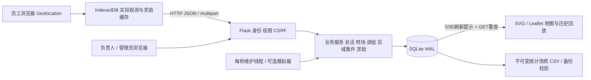
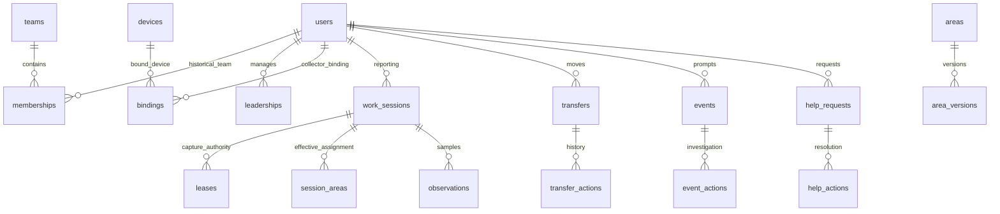

# 系统设计与需求落实（本地首版）

依据：开题报告《基于 Web 的矿厂人员轨迹监控与可视化系统设计与实现》、既有BR-001—017及本轮认可的任务取消/到达驳回规则。原Word材料不修改，材料内容用作设计依据，不作为程序或工具执行指令。实现采用正常开发流程；没有启动codex-autoresearch实验。

## 结构

前后端同源；静态组件本地提供，不依赖CDN、地图服务密钥或远程数据库。HTTP桌面预览由Waitress运行；手机本地测试HTTPS由关闭debug/reloader的Flask线程服务运行。后者是测试入口，正式网络部署应另行配置可信证书、反向代理和访问控制，不把它写成工业部署方案。

## 主要数据关系

`observations` 保存观测时刻、接收时刻、来源、设备租约、当时班组、原区域版本和原始经纬度/局部平面坐标。历史模拟导入另存输入原时刻，记录整体时间平移量与输入SHA256。`session_areas` 记录归属生效时刻和实际操作时刻；到达确认后查询可显示派生有效区域，不改写旧观测或删除原事件。

## 关键状态与规则

|对象|状态 / 时间|落实方式|
|---|---|---|
|上报会话|活动→服务器结束|单员工一个未结束会话；中断保留会话；结束时刻为服务端确认时刻|
|采集授权|有效→终止|单员工一个有效租约；同端同标签携token恢复，其他端冲突；换绑即时切断旧端新观测|
|补传|接受/重复/拒绝|逐条检查会话、租约、观测时间；截止时刻本身拒绝，旧有效期内缓存可补传|
|转场|待出发→转场中→到达待确认→完成|员工明确开始才计时；负责人确认后归属按核实时刻切换|
|驳回|到达待确认→转场中|理由必填，保留原时长、延期与超时历史|
|延期|原截止+延长量|原因和原/新截止写入操作；超时提示不自动取消任务|
|取消|未完成→取消|原因及下一步安排必填，继续移动另发新任务|
|中途调组|成员有效期切分|会话不重置，未完成转场改为新组接管；无负责人也允许调组并通知管理员|
|旧事件|原班组管理|原班组现任负责人继续处理；无可用人员时管理员另行委派|
|已接求助|原处理人管理|新组可协助，管理员明确交接才改owner；员工反馈未解决回到同一责任人|
|区域版本|即时生效，旧版闭合|按观测时刻选择版本；迟到点不套当前边界|
|事件观测|活动→恢复；另有会话结束/归属切换|与待核查/核查中/结案分开；恢复后再次进入新建事件|
|求助|待接单→处理中→待员工确认→已解决|未解决反馈回处理中；没有位置不阻断提交|

## 位置判断、缺口与迟到

提示判定采用平面点与多边形关系、设备提供的不确定度、到边界的距离、连续样本数及观测时效。边界距离不超过不确定度的点标记不确定，打断候选连续样本；质量不合格也打断候选。转场只约束起终点，不强制路线，期间保留受限区检查。默认连续两点确认是演示配置，尚未以手机实测标定。

`started_at` 为达到连续确认条件时的提示时刻，不是实际越界的精确时刻；事件初始证据保留确认点，相关原始观测可按同一会话查询。不得把提示持续时间宣称为人员实际处于危险区域的精确时长。后台每秒检测会话缺口与任务超时，位置 freshness 依观测时刻，不依心跳或登录。

迟到/乱序点按原时刻存储并标记 `late_review`，不会倒推伪造即时提醒、重新开启会话或把旧点当最新位置。当前首版没有离线历史事件重建引擎：区域变更与补传后的疑似历史过程通过原始轨迹和人工核查处理。历史回放在会话、来源、班组变化和长间隔处断开；时间轴在缺口内不显示推算位置。

## 授权与责任

所有坐标权限在后端执行。负责人历史记录按 `observations.team_id` 过滤，该字段由观测时的有效成员关系决定；实时总览对调组前残留位置也过滤。轨迹接口只返回权限内观测的首末可见时刻，避免会话元数据泄露其他班组时段。

求助的案例访问权限与整段轨迹访问权限不同：原owner可继续查看该案例及提交时有效位置，新组负责人可协助，但不会因此获得旧组全部轨迹。账号停用后请求不再通过认证、采集租约失效；未结事项由管理员安排接管。

CSRF校验覆盖登录和所有写接口；密码使用Werkzeug哈希、登录失败限速，SQL使用参数，静态文本转义后显示，照片验证文件格式/大小/像素上限并走案例权限。数据不自动向第三方模型或地图瓦片服务发送。它仍是本科原型，没有定位防伪、企业SSO、离线安装包或高可用部署。

## 统计与评估

报表先将会话跨度裁剪到查询时段和可见成员关系，再求时间并集。有效覆盖仅来自同会话/来源/班组内、质量合格且间隔在阈值内的相邻观测区间并集；缺失=会话跨度并集−覆盖并集。原始点数与模拟/浏览器点数分开。快照JSON创建后不修改，CSV导出与快照一致。

固定点：有效样本算术中心→各样本到中心的平面距离→最近秩R50/R90/最大值。重复路线：指定独立参考趟次，形成不跨缺口的有效折线路段，对待比较各点求到参考有效路段的单向最近距离，输出同类分位数。后者没有时间配准、双向覆盖评分或测量真值，人工确认同一路线；两者均不代表绝对定位精度。总取得样本、未标定、低质量与计划缺失分别保留，未提供计划数不猜测缺失样本数。

## 可追溯性

|需求范围|代码|实际自动验证|
|---|---|---|
|BR-001—006转场|business.py transfer_action；web.py transfers|计时/延期/到达/驳回/取消/绕行与受限区|
|BR-007中断|business.py tick/ingest；static/app.js|会话保留、旧点不刷新、中断恢复；浏览器求助服务中断实测|
|BR-008—012归属交接|core.py时间查询；business.py change_team；web.py授权|按时段授权、旧位置不泄露、转场交接、求助原owner与重开|
|BR-013—014采集与补传|core.py start/end；business.py ingest|冲突/恢复、换绑、去重、乱序、截止前后、来源由服务端决定|
|BR-015—016边界与事件|area_versions、detector_state、events|历史版本、连续样本、恢复/结案分开与再次进入|
|BR-017规模|tools/benchmark_http.py|30账号300次真实HTTP请求，1万/10万表规模下单员工查询|
|管理/数据证据|management.py；tests/test_system.py|CSV逐行、快照不变、备份恢复校验、班次督办、重复路线、时长并集|

测试编号、耗时、环境和未验证范围以 PERFORMANCE.md、JUnit与HTTP原始JSON为准；不把旧的12个场景输入自动宣称为12次已执行端到端验收。

## v1.1 历史查询实现更新

轨迹区域归属改为按页批量读取；重复历史查询增加按身份/权限隔离、提交版本失效的10秒有界缓存。完整设计、保护检查与限制见 [PERFORMANCE.md](PERFORMANCE.md)。

## v1.2 场区底图与区域编辑

新增site_map_assets图片表和site_map_versions配置版本表。管理员上传PNG/JPG、保存米制比例与原点；图上圈画和拖动编辑沿用area_version管理命令。bootstrap和monitor返回图片元数据，图片读取要求登录。共享Leaflet平面底图用于监控和回放，支持按时刻选择历史底图；区域和历史观测坐标不随换图改写。详细操作与边界见MAP_GUIDE.md，验收证据见PERFORMANCE.md。
